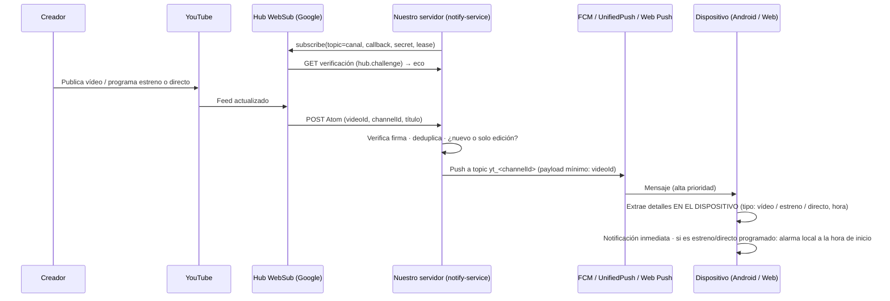

# ADR-006 · Notificaciones en tiempo real de nuevos vídeos, estrenos y directos

- **Estado:** Propuesto (2026-11-06)
- **Requisito:** RF-035

## Problema (verificado)
Los clientes alternativos **no reciben avisos: preguntan periódicamente**.
- NewPipe usa `PeriodicWorkRequest` de WorkManager con intervalos de 15 min, 30 min, 1 h, 2 h, 4 h, 12 h o 1 día [V-código: `settings_keys.xml`, `streams_notifications_interval`]. 15 minutos es además el mínimo que permite Android para trabajo periódico [I: limitación conocida de WorkManager].
- En PipePipe, Flow y LibreTube hay **0 referencias** a FCM, UnifiedPush o WebSub [V-código].
- Resultado:
  - el usuario se entera tarde (hasta el intervalo configurado, y más con Doze);
  - cada teléfono consulta todos los canales una y otra vez, con más batería, más datos y más bloqueos “not a bot”.

## Decisión
Usar **WebSub (PubSubHubbub)**, el mecanismo **oficial** de YouTube para recibir notificaciones push cuando un canal publica o actualiza un vídeo. Lo documenta la guía “Push notifications” de la YouTube Data API ([developers.google.com/youtube/v3/guides/push_notifications](https://developers.google.com/youtube/v3/guides/push_notifications)), con estas características:
- **Hub:** `pubsubhubbub.appspot.com`.
- **Topic:** `https://www.youtube.com/xml/feeds/videos.xml?channel_id=<ID>`.
- **Entrega:** POST de Atom al *callback* del servidor cuando se sube un vídeo o cambia su título o descripción.
- **Firma:** HMAC (`X-Hub-Signature`) si se define `hub.secret`.
- **Lease:** limitado, con renovación periódica; Invidious usa 432 000 s (5 días) [S: commit de Invidious].
- **Coste:** no consume cuota de la API [S].

Las páginas de Google se leyeron como extractos de buscador, no completas: hay que verificarlas (doc 00 §6).

### Flujo

### Reglas de diseño
1. **El servidor nunca extrae YouTube.** Solo recibe WebSub (oficial) y, como respaldo, lee el RSS público. Los detalles (miniatura, duración, si es estreno o directo) los obtiene el dispositivo al recibir el push. Así evitamos bloqueos de IP y riesgo legal en el servidor.
2. **Privacidad por diseño:**
   - Con **FCM topics** (`yt_<channelId>`), el dispositivo se suscribe al topic y el servidor publica en el topic **sin saber qué usuario sigue qué canal**. El servidor solo conoce el conjunto agregado de canales con al menos un suscriptor.
   - Con **UnifiedPush y Web Push** no hay topics, así que el servidor guarda `endpoint → canales`. Los endpoints son anónimos (sin cuenta) y se pueden revocar.
3. **Tres canales de entrega**, según la build:
   - `play`: **FCM**;
   - `full` (F-Droid): **UnifiedPush**, con un distribuidor como ntfy, sin servicios de Google [S: [F-Droid, UnifiedPush](https://f-droid.org/sq/2022/12/18/unifiedpush.html)];
   - web: **Web Push** (VAPID + Service Worker; en iOS solo con la PWA instalada [I, NV]).
4. **Estrenos y directos:**
   - Al recibir el aviso de un vídeo nuevo, el dispositivo detecta si es *upcoming* y su hora programada. Notifica “Estreno programado a las HH:MM” y agenda una **alarma local exacta** para notificar “Empieza ahora”.
   - El inicio real del directo no está garantizado por WebSub (la evidencia es escasa y antigua [S: issue tehpsalmist/youtube-live-notifier#1]). Por eso, en los 10 minutos alrededor de la hora programada, el dispositivo comprueba el estado del vídeo concreto: una sola petición, no todo el feed.
5. **Respaldo (no se puede depender de un único mecanismo):**
   - El servidor consulta el RSS público de los canales seguidos cada 10–15 min, **una vez por canal para todos los usuarios**.
   - Si un push no llega, el respaldo lo detecta y lo envía.
   - Sin distribuidor push en el dispositivo, se vuelve al sondeo local de 15 min o más (como NewPipe).
6. **Control del usuario:** por canal, elegir entre todos, solo directos y estrenos, o ninguno; horas de silencio; agrupación de notificaciones.

## Expectativa honesta de latencia
- **Objetivo:** aviso en **≤ 2–3 minutos** desde la publicación.
  - Fuentes secundarias indican que las notificaciones por feed llegan “en un par de minutos”, no al instante [S: [streamcord](https://streamcord.io/blog/youtube-live-notifications-discord/)].
  - Las notificaciones oficiales de YouTube a sus usuarios tardan 10–20 min en enviarse a todos y se limitan a 3 por canal al día [S: [YouTube Help](https://support.google.com/youtube/answer/7389684?hl=en)].
  - Si se confirma, **podríamos avisar antes que la propia app de YouTube**. Hay que medirlo antes de afirmarlo (constitución §16).
- **No** se promete un aviso instantáneo al segundo.

## Coste
- Un solo servicio pequeño (`notify-service`): suscripciones WebSub con renovación, recepción, deduplicación y envío.
- FCM es gratuito. UnifiedPush usa servidores de terceros o propios (ntfy autoalojable). Web Push es gratuito.
- Coste lineal con el número de **canales distintos**, no de usuarios.

## Riesgos
| Riesgo | Mitigación |
|---|---|
| YouTube deja de enviar WebSub o lo restringe | Respaldo con RSS en el servidor; sondeo local |
| Avisos duplicados por ediciones de título | Deduplicar por `videoId` + primera vez visto |
| Abuso del callback (spam) | Verificar HMAC, aceptar solo topics suscritos, rate limit |
| Privacidad (el servidor conoce canales) | Topics de FCM; endpoints anónimos; sin cuenta obligatoria |

## Enmienda 1 (2026-11-07): el RSS no es un respaldo fiable; detección de Shorts

**Hallazgo:**
- El RSS público (`/feeds/videos.xml?channel_id=`) devuelve **404/500 intermitentes**, sobre todo a IP de servidores.
  - Desde este entorno: 404 en 3 de 3 canales válidos, 3 veces seguidas.
  - Desde Cloudflare: falló en 9 de 14 canales en la primera vuelta.
- Hay informes públicos desde diciembre de 2025: [web-boris#61](https://github.com/nelsonmarro/web-boris/issues/61), [ocaml.org#3512](https://github.com/ocaml/ocaml.org/issues/3512), [miniflux#4261](https://github.com/miniflux/v2/issues/4261).
- **WebSub sí funciona:** han llegado vídeos nuevos por esa vía.

**Decisión:**
1. **WebSub es la fuente principal.** El RSS queda como complemento oportunista y **nunca** se usa para validar ni descartar canales.
2. La validación de que un canal existe la hará la app de Android (extractor en el dispositivo) al seguirlo. En la web, un canal sin confirmar queda como “Sin confirmar”, no como “No existe”.
3. El respaldo ante un aviso perdido pasa al **dispositivo**: al abrir la app, el extractor revisa los canales seguidos con la IP del usuario.

**Detección de Shorts** (requisito: no mezclarlos con los vídeos):
- Los Shorts tienen miniatura vertical pública: `i.ytimg.com/vi/<id>/oardefault.jpg` → 200; los vídeos normales → 404.
- Verificado con 60 vídeos el 2026-11-07: 13 Shorts, 0 falsos positivos al revisar los títulos.
- Es un **comportamiento no documentado** [I]: si cambia, `kind` queda vacío y el vídeo se muestra como vídeo normal (no se rompe nada).
- La consulta es a la CDN pública de imágenes, el mismo recurso que muestra cualquier cliente. No es extracción de páginas de YouTube (constitución §I.2).
- Alternativas descartadas: oEmbed (devuelve las mismas dimensiones para Shorts y vídeos, verificado); `youtube.com/shorts/<id>` (página de YouTube desde el servidor, contra §I.2).

## Enmienda 2 (2026-11-07): detección de Shorts por la URL `/shorts/`
- **Fallo detectado por el propietario:** los Shorts de CNN y NBC salían mezclados con los vídeos. La miniatura vertical (`oardefault.jpg`) no existe para todos los Shorts: falsos negativos.
- **Señal nueva:** `HEAD https://www.youtube.com/shorts/<id>` con `redirect: manual` → **200** = Short, **3xx** = vídeo (redirige a `/watch`). Verificado en 4 casos dudosos (3 Shorts y 1 vídeo de CNN/NBC) y en la reclasificación de 159 vídeos (de 33 Shorts se pasó a ≥ 47).
- **Respeto a la constitución §I.2:** solo se lee el código de estado de una URL pública. No se descarga ni se interpreta contenido, ni se extrae nada del vídeo. La miniatura vertical queda como respaldo.
- **Lección:** verificar con al menos 3 canales distintos antes de dar por buena una heurística (la anterior se probó solo con BBC y DW).

## Enmienda 3 (2026-11-07): datos públicos sin Puente — RSS enriquecido y foto del canal
**Problema:** sin TodoTube Puente no había fotos de canal, visitas ni descripciones.

**Hallazgos (docs/research/10):**
- El RSS público que ya leemos trae, por vídeo, `media:statistics views` (visitas), `media:starRating count` (me gusta), `media:description` y un enlace `/shorts/ID` en los Shorts. No trae duración ni foto del canal.
- La API oficial de datos de YouTube daría fotos y duraciones, pero sus normas prohíben bloquear anuncios en las apps que la usan (riesgo de perder la clave o la cuenta de Google): **descartada**.
- La página pública del canal incluye metadatos de vista previa (Open Graph): `og:image` = foto del canal en `yt3.googleusercontent.com`, `og:title` = nombre.

**Decisión del propietario:**
1. El servidor guarda visitas, me gusta y descripción del RSS y los refresca en cada lectura. El enlace `/shorts/` del RSS sirve para clasificar Shorts sin otra petición.
2. El servidor lee **solo `og:image` y `og:title`** de la página de cada canal seguido, **una vez al día** (el propietario pidió diario en vez de semanal), leyendo por partes y cortando en cuanto los encuentra. Si YouTube lo bloquea, se muestran iniciales.
3. Nada de vídeos ni de usuarios. Ninguna API con normas incompatibles.
