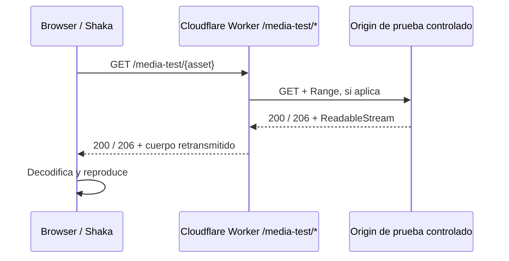

# ADR-009 - Gateway multimedia sin extension para la web

- **Proyecto:** TodoTube (repositorio: `Papeloncon-Code/AlternativaY`)
- **Estado:** Propuesto para aprobacion del propietario; no autoriza despliegue en produccion.
- **Fecha:** 2026-11-07
- **Responsable:** Propietario del producto
- **Relacion:** Complementa ADR-005 y la investigacion `docs/research/07-reproductor-propio-web-investigacion-a-fondo.md`. No los sustituye.

## 1. Resumen ejecutivo

Se evaluan cuatro rutas para reproducir en la web sin pedir al usuario instalar TodoTube Puente:

1. Mantener la descarga directa desde el navegador y el Puente actual.
2. Interponer un gateway multimedia en Cloudflare Workers.
3. Ejecutar un proxy multimedia dedicado, siguiendo el modelo de Piped (`piped-proxy`, Rust) o Invidious Companion.
4. Usar el reproductor oficial incrustado de YouTube.

**Recomendacion:** conservar la ruta directa + Puente como ruta de reproduccion propia para la build `full`; mantener el reproductor oficial como ruta compatible sin Puente / build `play`; y construir solamente una prueba de concepto de gateway con contenido propio o una fuente cuyo relay este autorizado. No desplegar un gateway que retransmita streams de YouTube hasta resolver expresamente el conflicto con ADR-005 y obtener revision legal escrita.

La conclusion tecnica es positiva, pero no equivale a una aprobacion de producto: Cloudflare Workers puede retransmitir respuestas grandes mediante streams sin almacenarlas completas en memoria. Por tanto, es tecnicamente viable eliminar la extension mediante un proxy del mismo origen. Sin embargo, cada peticion de segmento atravesaria infraestructura de TodoTube, la salida hacia YouTube procederia de IP de servidor y la empresa asumiria disponibilidad, abuso, costes por solicitud y un riesgo contractual mayor.

## 2. Contexto y problema actual

### 2.1 Flujo real del codigo

La web ya contiene dos reproductores:

- `OwnPlayer.tsx` inicializa `TodoTubePlayer` (Shaka + SABR) cuando el Puente esta disponible.
- `OfficialPlayer.tsx` crea un `YT.Player` sobre `youtube-nocookie.com` como reproductor oficial de reserva.
- `PlayerHost.tsx` selecciona el reproductor propio cuando `useBridge()` es verdadero y la sesion no tiene fallback; en caso contrario monta `OfficialPlayer`.

El Puente no retransmite todo el video. Hay dos caminos distintos:

1. **Solicitudes de datos / player:** `bridgeFetch.ts` manda las peticiones de `youtubei.js` a `bridgeApi().fetch()`. La ruta `initplayback` usa `fetch()` directo.
2. **Segmentos multimedia:** `ShakaPlayerAdapter.ts` registra los esquemas HTTP/HTTPS y ejecuta `fetch(uri, init)` desde el contexto de la pagina. Las reglas DNR de `apps/bridge/rules.json` modifican cabeceras Origin/Referer y cabeceras CORS de las respuestas `googlevideo.com`.

La extension tambien limita los origenes admitidos: `manifest.json` y `rules.json` contienen el dominio `todotube.papelon.workers.dev` y localhost. Un futuro dominio de produccion debe incluirse y probarse de forma explicita.

**Implicacion:** el cuello de botella no es que la extension transporte cada byte del video. El Puente habilita solicitudes que la pagina no puede completar bajo las reglas normales del navegador. La descarga de segmentos, hoy, va directamente del navegador a Googlevideo.

### 2.2 Restriccion del navegador

El reproductor actual usa Shaka y un adaptador que necesita leer y procesar respuestas multimedia mediante Fetch/ReadableStream. Una pagina web no puede hacer que `fetch()` lea libremente respuestas de un origen que no autoriza su origen mediante CORS. `mode: no-cors` no es un reemplazo: produce una respuesta opaca que no sirve al procesamiento que necesita el adaptador.

Para mantener un reproductor propio sin extension, las alternativas reales son:

- que el origen multimedia autorice CORS;
- interponer un endpoint del mismo origen que haga el fetch remoto y retransmita la respuesta;
- abandonar el reproductor propio y utilizar el reproductor oficial.

## 3. Evidencia de alternativas

### 3.1 Piped

Piped usa un frontend web con un elemento `<video>` y Shaka Player. Sus streams incluyen una direccion de proxy. El proyecto `TeamPiped/piped-proxy` esta escrito en Rust y su codigo incluye:

- transmision de cuerpos con streams, en lugar de cargar el video entero en memoria;
- manejo de solicitudes `Range` y respuestas parciales `206`;
- reescritura de URLs de manifiestos HLS y DASH;
- cabeceras CORS;
- una ruta de procesamiento UMP (`UmpTransformStream`).

Referencias:
- https://github.com/TeamPiped/Piped/blob/master/src/components/VideoPlayer.vue
- https://github.com/TeamPiped/Piped-Backend/blob/master/config.properties
- https://github.com/TeamPiped/piped-proxy/blob/main/src/main.rs

**Lo que demuestra:** una web puede usar un reproductor propio sin extension si el backend/proxy entrega los recursos con las cabeceras y el transporte que el navegador necesita.

**Lo que no demuestra:** que el proxy sea siempre estable, legalmente autorizado o inmune a bloqueos de IP. Tampoco elimina el coste operativo: lo desplaza al operador del proxy.

### 3.2 Invidious + Companion

Invidious separa la aplicacion principal del servicio Companion, que gestiona la obtencion de streams. Su documentacion permite publicar Companion detras de un reverse proxy y servir los streams directamente por una ruta o subdominio, precisamente para mejorar la reproduccion con varios usuarios.

Referencias:
- https://github.com/iv-org/invidious-companion
- https://docs.invidious.io/installation/#post-install-configuration

**Lo que demuestra:** el proxy de streams puede ser un servicio independiente y escalarse/separarse del backend de metadatos.

**Advertencia operativa:** la propia guia de instalacion de Invidious recomienda reinicios frecuentes por problemas conocidos. No debe interpretarse el proyecto como evidencia de mantenimiento cero.

### 3.3 FreeTube y Kira

FreeTube es una aplicacion Electron de escritorio: ejecuta la logica de red en un entorno local de aplicacion, no dentro de una pagina web ordinaria. No demuestra una solucion web pura sin extension ni servidor.

La investigacion interna `docs/research/07-reproductor-propio-web-investigacion-a-fondo.md` identifica Kira y otros clientes web que recurren a un puente de navegador. Es una evidencia adicional de que el puente no es una peculiaridad de TodoTube: responde a una frontera real del navegador.

## 4. Opciones consideradas

| Opcion | Instalacion del usuario | Donde se hace el fetch de segmentos | Ventajas | Costes y riesgos | Veredicto |
|---|---|---|---|---|---|
| A. Directo + Puente | Si | Navegador del usuario | El trafico multimedia no cruza nuestros servidores; usa la IP del usuario; aprovecha el codigo actual | Friccion de instalacion; soporte por navegador/dominio; dependencia de extension | **Mantener ahora** |
| B. Cloudflare Worker como gateway del mismo origen | No | Worker de TodoTube | CORS resuelto por mismo origen; escala en edge; streaming sin buffer completo; encaja con el dominio Workers actual | IP de salida de servidor; peticiones por segmento; abuso, politicas, telemetria, fiabilidad y riesgo legal; PoToken/sesion sin validar | **PoC limitada, no produccion YouTube** |
| C. Proxy dedicado Rust/Go | No | Contenedor/servidor TodoTube | Control fino de conexiones, pooling, streaming, UMP y observabilidad; referencia directa Piped | Infraestructura persistente; salida y transferencia; despliegue/monitorizacion; IP de datacenter; mas trabajo para una persona | **No para MVP** |
| D. IFrame oficial | No | YouTube controla la reproduccion | Menor complejidad propia; no se transportan segmentos por TodoTube | Marca/controles oficiales; menos integracion; politicas oficiales aplicables | **Ruta sin Puente compatible** |

## 5. Evaluacion de Cloudflare Workers

Cloudflare Workers es la opcion mas economica para validar la arquitectura, no una garantia de que retransmitir YouTube sea viable.

La documentacion oficial consultada indica:

- Workers puede devolver un `ReadableStream` y retransmitir cuerpos de varios GB sin acumularlos completos en memoria; el runtime tiene 128 MB de memoria.
- Las solicitudes HTTP no tienen un limite fijo de duracion mientras el cliente siga conectado. Las interrupciones de runtime, desconexiones o presion de recursos siguen siendo posibles.
- En Free: 100.000 solicitudes/dia, 10 ms de CPU por invocacion y 50 subrequests externos por invocacion.
- El limite documentado de conexiones salientes concurrentes es 6 por invocacion. El diseno propuesto haria una sola solicitud upstream por invocacion, sin fan-out de segmentos.
- En Standard/Paid: 10 millones de solicitudes/mes incluidas; luego USD 0,30 por millon adicional; 30 millones de milisegundos de CPU incluidos; luego USD 0,02 por millon de ms. El minimo del plan es USD 5/mes.
- El plan Paid no cobra transferencia de datos ni throughput. Esto no convierte el gateway en gratuito: se siguen contando las solicitudes de entrada y el CPU.
- El limite documentado de conexiones salientes concurrentes por invocacion es 6. El diseño propuesto hace una solicitud upstream por invocacion y no debe fan-out de segmentos dentro de una misma peticion.

Fuentes oficiales:
- https://developers.cloudflare.com/workers/runtime-apis/streams/
- https://developers.cloudflare.com/workers/platform/limits/
- https://developers.cloudflare.com/workers/platform/pricing/

### 5.1 Modelo de coste

No se debe presupuestar por GB solamente. Para un gateway de segmentos, la metrica primaria de Workers es el **numero de solicitudes** que alcanzan el Worker; cada solicitud de segmento puede convertirse en una invocacion del Worker.

Formula para medir con el reproductor real:

`solicitudes_gateway = reproducciones_iniciadas x solicitudes_HTTP_medias_por_reproduccion`

El numero de solicitudes HTTP por reproduccion debe obtenerse de DevTools/telemetria en videos reales, no suponerse. Deben medirse VOD, directos, seeking, cambio de calidad, subtitulos y reintentos por separado.

La transferencia/throughput no tiene cargo adicional en Workers Paid segun la tabla oficial consultada, pero el producto sigue expuesto a limites de plan, CPU, numero de solicitudes, bloqueos upstream y posibles cambios de precio.

### 5.2 Limitaciones especificas

1. **IP de salida:** el upstream ve una IP de Cloudflare/servidor, no la IP del usuario. La arquitectura pierde una de las ventajas principales de ADR-005.
2. **Bloqueos upstream:** un Worker no puede reparar un `403`, bloqueo regional, expiracion de URL o rechazo de sesion/PoToken. Un gateway solo retransmite lo que recibe.
3. **Contexto/token:** no se ha demostrado que los tokens y las sesiones generadas en el navegador funcionen sin cambios cuando la peticion final se origina desde el Worker. Es una puerta de validacion, no una suposicion.
4. **Protocolos:** deben probarse UMP/SABR, DASH, HLS, respuestas parciales, redirecciones, errores recuperables y manifiestos. Un proxy HTTP generico no garantiza compatibilidad SABR.
5. **Abuso:** un endpoint publico que acepta URLs arbitrarias se convierte en un open proxy/SSRF. No se permite implementar un proxy abierto.
6. **Cache:** los streams tienen URLs y tokens firmados y temporales. No cachear ni persistir bytes por defecto. Cualquier cache requiere revision tecnica, contractual y legal independiente.

## 6. Conflicto con ADR-005 y riesgo legal

ADR-005 establece que la extraccion se ejecuta solo en el dispositivo del usuario y nunca en nuestros servidores. Tambien justifica esa separacion por los bloqueos de IP de centros de datos y por no concentrar el riesgo legal en la empresa.

Un Worker que recibe la URL de un stream y hace `fetch()` al upstream para devolver el cuerpo **no tiene que extraer los metadatos ni generar el stream**, pero si solicita y retransmite el contenido desde infraestructura de TodoTube. Por tanto:

- contradice la finalidad arquitectonica de mantener la obtencion del contenido en el dispositivo;
- mueve las solicitudes upstream a IP controladas por la infraestructura;
- aumenta la responsabilidad de TodoTube sobre el relay y la disponibilidad;
- no puede tratarse como un simple cambio de CORS o como una extension de ADR-005.

Los Terminos de Servicio de YouTube restringen el acceso automatizado y la reproduccion/transmision de contenido salvo autorizacion. Las politicas de YouTube API Services agregan requisitos especificos para clientes que usan esos servicios, pero su alcance no debe confundirse con el analisis de endpoints privados/no oficiales. La evaluacion contractual de la extraccion no oficial y del relay de streams debe hacerla un abogado con las fuentes primarias completas antes de lanzar o monetizar.

Fuentes:
- https://www.youtube.com/t/terms
- https://developers.google.com/youtube/terms/developer-policies/
- `docs/research/05-legal-y-viabilidad.md` (riesgo RL-10 y ADR-005).

**No se autoriza** construir rotacion de IP, resolucion de CAPTCHA, falsificacion de clientes ni generacion server-side de atestaciones/tokens para eludir controles. Si el upstream deniega el acceso, el sistema debe clasificar el error y presentar una alternativa permitida, no evadirlo.

## 7. Decision propuesta

### 7.1 Decision

1. **Se conserva la ruta A (directo + Puente)** para el reproductor propio de la web `full` durante esta iteracion.
2. **Se conserva la ruta D (IFrame oficial)** como opcion sin Puente y para la build `play`, con atribucion y comportamiento exigidos por las politicas aplicables.
3. **Se autoriza un PoC tecnico de la ruta B (Cloudflare Worker)** solo con un origen de prueba controlado por TodoTube o una fuente cuya retransmision este autorizada. El PoC no debe acceder ni retransmitir streams de YouTube.
4. **No se aprueba C (proxy Rust/Go) para el MVP.** Solo se reconsidera si el PoC demuestra una necesidad real que Workers no resuelve y existe aprobacion legal/operativa.
5. No se modifica ADR-005. Una futura adopcion de gateway para YouTube exige una nueva decision explicita del propietario y revision legal escrita. Si la respuesta legal no autoriza el relay, no se implementa para YouTube.

### 7.2 Motivo

La ruta A preserva la decision ya aceptada, evita que el servidor sea el origen de las solicitudes de stream y requiere menos infraestructura. La ruta B es tecnicamente viable y es la primera candidata para una web sin extension, pero su mayor ventaja de UX no compensa por ahora la contradiccion con ADR-005, el riesgo de IP y la falta de pruebas de SABR/PoToken desde servidor.

### 7.3 Consecuencia visible para el usuario

No se puede prometer simultaneamente, en la arquitectura actual, todo lo siguiente: reproductor propio, contenido de YouTube, pagina web pura sin extension, cero relay de servidor y ausencia de autorizacion CORS upstream. Hay que escoger una ruta:

- Reproductor propio + Puente; o
- reproductor oficial sin Puente; o
- gateway de servidor, solo si se aprueban las consecuencias tecnicas y legales.

## 8. Arquitectura del PoC permitido

El PoC debe validar el transporte sin involucrar YouTube:

### 8.1 Requisitos de seguridad del PoC

- Ruta de origen fija o allowlist estricta; no aceptar un `url` arbitrario enviado por el cliente.
- No permitir esquemas distintos de HTTPS ni hosts fuera de la allowlist.
- No reenviar cookies, `Authorization` ni cabeceras de identidad del usuario al origen de prueba.
- Usar identificadores opacos y firmados con expiracion para cualquier destino dinamico autorizado.
- Limitar tasa, tamaño de cabeceras y concurrencia; tener interruptor remoto para desactivar el gateway.
- No escribir cuerpos multimedia, URLs firmadas ni tokens en logs.
- Desactivar cache por defecto y no persistir los bytes.
- Manejar desconexion del cliente y abortar el fetch upstream asociado.

### 8.2 Compatibilidad HTTP obligatoria

El PoC debe preservar o reconstruir correctamente, segun corresponda:

- `GET`, `HEAD`, `OPTIONS`;
- `Range: bytes=...`;
- `200`, `206`, `304` solo si se usan validadores, `416` y errores upstream;
- `Content-Type`, `Content-Length`, `Content-Range`, `Accept-Ranges`, `ETag`, `Last-Modified` cuando el origen los proporcione y sean validos;
- cancelacion, backpressure y streaming sin `arrayBuffer()`/`text()` sobre el cuerpo multimedia.

No reescribir ni descomprimir el cuerpo de video. Si un manifiesto debe modificarse, hacerlo en una capa separada y con fixtures DASH/HLS.

## 9. Plan SDD: tareas y criterios de aceptacion

| ID | Fase | Tarea | Criterio de salida |
|---|---|---|---|
| GW-01 | Investigacion | Instrumentar ruta actual: numero de requests, hosts, tamanos, Range, latencia, 403/429/5xx, primer frame y rebuffering. | Baseline reproducible para 10 videos VOD, 2 directos y 3 Shorts; logs sin tokens/URLs firmadas. |
| GW-02 | Especificacion | Formalizar interfaz `MediaTransport` (directo / gateway / oficial) sin cambiar el comportamiento por defecto. | Pruebas unitarias de seleccion de transporte; ningun cambio a ADR-005. |
| GW-03 | PoC | Crear Worker `/media-test/*` con origen de prueba propio y streaming transparente. | VOD de 30 min, seek aleatorio, HEAD, rango parcial, desconexion y reconexion funcionan sin cargar el cuerpo completo en memoria. |
| GW-04 | QA | Probar Firefox y Chromium de escritorio y movil compatible; comparar directo vs Worker. | No hay regresion funcional; TTFF p50 no empeora mas del 15% en la misma region de prueba; throughput sostenido >= 1,5x el bitrate configurado durante 30 min. |
| GW-05 | Capacidad | Medir 1, 5 y 10 sesiones concurrentes, invocaciones, CPU, errores y costes. | Informe de coste medido con formula real de requests/reproduccion; alertas y limites configurados. |
| GW-06 | Seguridad | Revisar open-proxy, SSRF, firma/expiracion, rate limit, logs, cache y cancelacion. | Ningun destino arbitrario; pruebas negativas de hosts, esquemas y tokens expirados. |
| GW-07 | Legal | Obtener revision legal escrita sobre relay server-side de streams de YouTube y alcance de ToS/API. | Dictamen documentado antes de cualquier prueba contra streams reales o despliegue de gateway YouTube. |
| GW-08 | Decision | Si GW-03..GW-07 pasan, redactar ADR de adopcion y actualizar ADR-005 y especificaciones afectadas. | Aprobacion expresa del propietario; sin aprobacion, se archiva el PoC como experimento. |

Los umbrales de rendimiento de GW-04 son objetivos iniciales del PoC, no garantias de produccion. Se ajustaran solo despues de medir la ruta directa en condiciones equivalentes.

## 10. Metricas y observabilidad

### Baseline de la ruta directa

- tiempo desde clic hasta `loadeddata` y `playing`;
- tiempo hasta primer fotograma (`requestVideoFrameCallback` cuando este disponible);
- bytes descargados, cantidad de solicitudes y duracion por host;
- porcentaje de solicitudes `2xx/206`, `403`, `429`, `5xx`, timeouts y abortos;
- rebuffering total y eventos `waiting/stalled`;
- exito de seek, seleccion de calidad, pista de audio y subtitulos.

### Gateway PoC

Anadir `gateway_request_id`, tipo de operacion (`manifest`, `segment`, `range`, `head`), status upstream/downstream y duracion. No registrar URL completa, query strings firmadas, cookies, PoTokens ni credenciales.

## 11. Riesgos y mitigaciones

| Riesgo | Probabilidad | Impacto | Mitigacion |
|---|---|---|---|
| IP de salida del servidor bloqueada por upstream | Alta / no medida | Alto | Mantener ruta directa; no intentar evadir bloqueos; clasificar fallo. |
| Incompatibilidad SABR/UMP a traves de proxy | Media-alta | Alto | Fixtures y PoC; no asumir que un proxy generico funciona. |
| Exceso de solicitudes Worker por segmentos | Media | Medio-alto | Medir requests por reproduccion; limites, alertas y presupuesto. |
| Gateway abierto / SSRF | Media | Critico | Allowlist, URLs firmadas, sin destinos arbitrarios, tests negativos. |
| Desconexion deja fetch upstream activo | Media | Medio | Propagar AbortSignal y probar cierre de streams. |
| Conflicto con ADR-005 / ToS | Alto | Critico | No retransmitir YouTube hasta aprobacion legal y nuevo ADR. |
| Complejidad para equipo de una persona | Alta | Alto | Limitarse al PoC; no introducir Rust proxy en el MVP. |

## 12. Condiciones para reconsiderar la decision

El gateway de YouTube solo puede pasar a produccion si se cumplen todas estas condiciones:

1. Revision legal escrita que analice expresamente la retransmision server-side de streams de YouTube, no solo la extraccion local.
2. Confirmacion del propietario para cambiar ADR-005.
3. Pruebas de compatibilidad real con formatos, sesiones, tokens y expiracion, sin construir mecanismos para evadir controles.
4. Evidencia de que los bloques por IP de salida, si aparecen, no requieren rotacion ni otros mecanismos de elusion.
5. Modelo de coste y capacidad sustentado por mediciones de la aplicacion, no por cifras teoricas.
6. Plan de abuso, seguridad, observabilidad, caida del gateway y recuperacion.

Si cualquiera falla, se mantiene la ruta A + D.

## 13. Referencias

### Codigo TodoTube (rama `sdd/investigacion-y-especificacion`)

- [ADR-005 - Cliente de YouTube completo](https://github.com/Papeloncon-Code/AlternativaY/blob/sdd/investigacion-y-especificacion/docs/adr/ADR-005-cliente-youtube-completo.md)
- [Investigacion 07 - Reproductor propio web](https://github.com/Papeloncon-Code/AlternativaY/blob/sdd/investigacion-y-especificacion/docs/research/07-reproductor-propio-web-investigacion-a-fondo.md)
- [PlayerHost.tsx](https://github.com/Papeloncon-Code/AlternativaY/blob/sdd/investigacion-y-especificacion/apps/web/src/components/PlayerHost.tsx)
- [OwnPlayer.tsx](https://github.com/Papeloncon-Code/AlternativaY/blob/sdd/investigacion-y-especificacion/apps/web/src/components/OwnPlayer.tsx)
- [OfficialPlayer.tsx](https://github.com/Papeloncon-Code/AlternativaY/blob/sdd/investigacion-y-especificacion/apps/web/src/components/OfficialPlayer.tsx)
- [TodoTubePlayer.ts](https://github.com/Papeloncon-Code/AlternativaY/blob/sdd/investigacion-y-especificacion/apps/web/src/player/TodoTubePlayer.ts)
- [ShakaPlayerAdapter.ts](https://github.com/Papeloncon-Code/AlternativaY/blob/sdd/investigacion-y-especificacion/apps/web/src/player/ShakaPlayerAdapter.ts)
- [bridgeFetch.ts](https://github.com/Papeloncon-Code/AlternativaY/blob/sdd/investigacion-y-especificacion/apps/web/src/player/bridgeFetch.ts)
- [rules.json](https://github.com/Papeloncon-Code/AlternativaY/blob/sdd/investigacion-y-especificacion/apps/bridge/rules.json)
- [manifest.json](https://github.com/Papeloncon-Code/AlternativaY/blob/sdd/investigacion-y-especificacion/apps/bridge/manifest.json)

### Alternativas

- [Piped VideoPlayer.vue](https://github.com/TeamPiped/Piped/blob/master/src/components/VideoPlayer.vue)
- [Piped piped-proxy (Rust)](https://github.com/TeamPiped/piped-proxy/blob/main/src/main.rs)
- [Invidious Companion](https://github.com/iv-org/invidious-companion)
- [Invidious installation / Companion public URL](https://docs.invidious.io/installation/)

### Plataforma y politica

- [Cloudflare Workers Streams API](https://developers.cloudflare.com/workers/runtime-apis/streams/)
- [Cloudflare Workers Limits](https://developers.cloudflare.com/workers/platform/limits/)
- [Cloudflare Workers Pricing](https://developers.cloudflare.com/workers/platform/pricing/)
- [YouTube Terms of Service](https://www.youtube.com/t/terms)
- [YouTube API Services Developer Policies](https://developers.google.com/youtube/terms/developer-policies/)

---

**Estado final de esta iteracion:** ADR-009 propuesto; no aceptado ni desplegado. La decision de produccion permanece en ADR-005 hasta aprobacion expresa del propietario.
