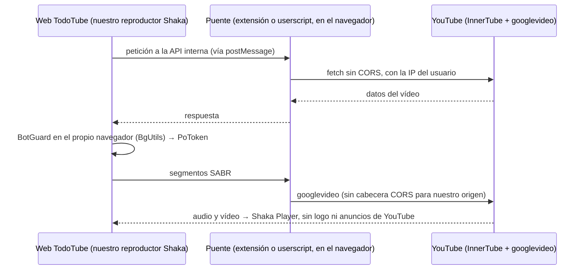

# 07 · Reproductor propio en la web: investigación a fondo

Consulta: 2026-11-07. Petición del propietario: “investiga en todos lados si alguien ya lo hizo; tómate el tiempo”. **Corrige y amplía el doc 06.**

## Conclusión
**Sí se puede tener en la web un reproductor propio sin la marca de YouTube, y ya existe al menos un proyecto que lo hace: Kira.** La condición es que el navegador tenga un **puente**, una extensión o un *userscript*, que haga las peticiones que el navegador bloquea (CORS). Sin el puente, en una web pura no se puede sin servidor intermediario (lo confirma el doc 06).

Esto respeta la constitución §I.2: la extracción ocurre **en el dispositivo del usuario** (su navegador, con su IP), no en nuestros servidores.

## Cómo funciona (piezas verificadas)
| Pieza | Qué hace | Evidencia |
|---|---|---|
| **Kira** ([LuanRT/kira](https://github.com/LuanRT/kira), MIT, último commit 2025-10-29) | Cliente web en Vue con **Shaka Player** que reproduce YouTube por SABR, con búsqueda, recomendaciones y descargas | [V-código]: `checkExtension()` busca `window.ytcBridge` (extensión puente); importa `bgutils-js`; 28 referencias a BotGuard. README: “Most mobile browsers do not support extensions; you'll need a proxy”. |
| **googlevideo** ([LuanRT/googlevideo](https://github.com/LuanRT/googlevideo), MIT, commit 2026-11-06) | Implementa SABR/UMP para reproductores web (`SabrStreamingAdapter`) | [V-repo]; ejemplo `examples/sabr-shaka-example` |
| **BgUtils** ([LuanRT/BgUtils](https://github.com/LuanRT/BgUtils), MIT, commit 2026-10-23) | Ejecuta el reto anti-bots (BotGuard) y genera el PoToken. **En un navegador real funciona de forma nativa**: “you still need a runtime environment that meets its checks” y “If you're in a browser like environment, you can also do it this way” | [V-doc] README |
| **YouTube.js** (MIT) | Cliente de la API interna; en el navegador necesita un proxy o un puente | [V-doc] `examples/browser/README.md` |
| **Puente con userscript** (proyecto [siphon, PR #8](https://github.com/maxgfr/siphon/pull/8), MIT, sep-2026) | ~80 líneas con `GM_xmlhttpRequest` (Tampermonkey/Violentmonkey) que levanta CORS sin servidor; la página habla con el script por `postMessage` | [S] (PR leído). Probado en Chrome y Firefox de escritorio y en Firefox Android, según su README |
| **Límite de ~1 minuto** sin PoToken | Siphon: “since 2026-10 googlevideo serves the clients a page can use about a minute of a stream and refuses the rest” | [S]. Por eso hace falta BgUtils (PoToken) |

### Flujo propuesto

## Lo que NO conviene (y por qué)
| Opción | Problema |
|---|---|
| Controles propios **encima** del reproductor oficial (Plyr, Vidstack con `controls=0`) | Técnicamente posible y lo hacen librerías populares. Pero las reglas oficiales lo **prohíben**: “You must not display overlays, frames, or other visual elements in front of any part of a YouTube embedded player” ([Required Minimum Functionality](https://developers.google.com/youtube/terms/required-minimum-functionality)). Los anuncios siguen. Los parámetros `modestbranding` y `showinfo` ya no tienen efecto [S]. |
| `rel=0` para quitar “Más vídeos” | Desde 2018 solo limita las sugerencias al mismo canal [S]; no las quita. |
| Servidor intermediario | Bloqueos de IP, coste de retransmitir el vídeo, riesgo legal (doc 06). |
| Direct Sockets (Chrome Isolated Web Apps) | Solo ChromeOS y modo empresa en 2026 ([blink-dev](https://groups.google.com/a/chromium.org/g/blink-dev/c/5R0P_aYBWQI)). Especulativo. |

## Limitaciones del puente
- **Chrome 138+:** el usuario debe activar **“Permitir userscripts”** en los detalles de la extensión gestora ([docs de Chrome](https://developer.chrome.com/docs/extensions/reference/api/userScripts)). Es fricción, aunque se puede guiar con una pantalla.
- **Una extensión propia en la Chrome Web Store** probablemente se rechace por funciones relacionadas con YouTube ([hilo de Chromium](https://groups.google.com/a/chromium.org/g/chromium-extensions/c/K17UE-7Bjgs)). Alternativas: userscript (Tampermonkey y Violentmonkey sí están en la tienda) o extensión firmada para Firefox.
- **Móvil:** la mayoría de navegadores móviles no admiten extensiones (Kira lo dice). Excepción: Firefox Android. Para el móvil, la **app de Android** sigue siendo la vía.
- **Rendimiento:** con `GM_xmlhttpRequest`, la respuesta llega cuando termina entera. Hay que pedir segmentos pequeños, y la latencia es algo mayor que con una extensión propia [S].
- **Mantenimiento:** sería un segundo extractor (YouTube.js en la web) además de NewPipeExtractor en Android. Doble trabajo ante cada cambio de YouTube.
- **Legal:** es el mismo perfil de riesgo aceptado en ADR-005 (extracción en el dispositivo del usuario).

## Alternativas a FreeTube (el propietario preguntó)
FreeTube era solo un ejemplo de app de escritorio. Otras:
- **Grayjay Desktop** (FUTO; licencia no comercial);
- **Flow Desktop** (beta, de los autores de Flow);
- **Minitube**; **VacuumTube** (envoltorio de la interfaz de TV de YouTube); **FreeTube+Tabs**; **OpenTubeX** ([AlternativeTo](https://alternativeto.net/software/freetube/?platform=windows));
- en la web: **Kira** (demostración técnica) y frontends con servidor como Invidious, Piped y Materialious.

## Recomendación
**Web con dos modos:**
1. **Con el puente TodoTube instalado** (userscript primero; extensión de Firefox después): reproductor propio Shaka + SABR, sin anuncios ni marca de YouTube, extracción en el navegador.
2. **Sin puente:** reproductor oficial como reserva, con una invitación clara a instalar el puente o la app.

Antes de comprometerlo en la especificación, hace falta un **spike (T-100)**:
- prototipo mínimo: puente (userscript) + YouTube.js + BgUtils + googlevideo + Shaka sobre nuestra web;
- medir si reproduce vídeos completos en Chrome y Firefox de escritorio;
- medir el tiempo hasta el primer fotograma y la fricción de instalación.
