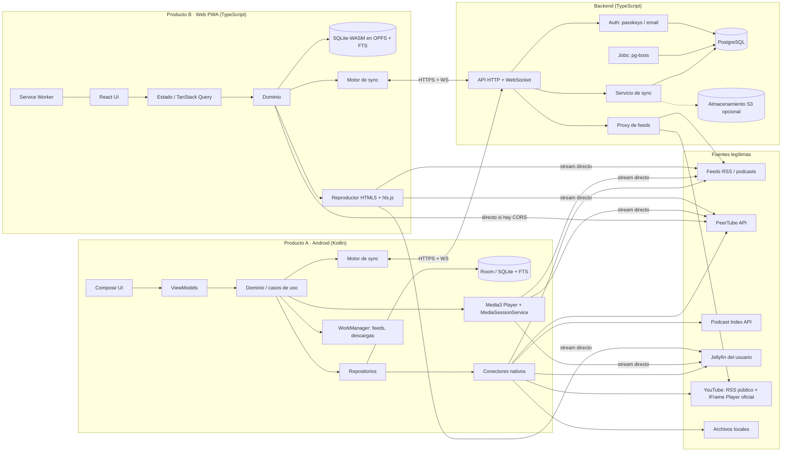
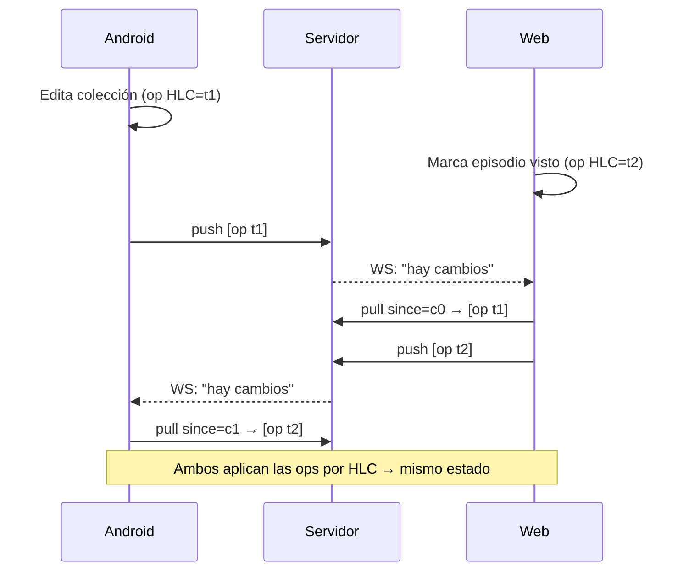
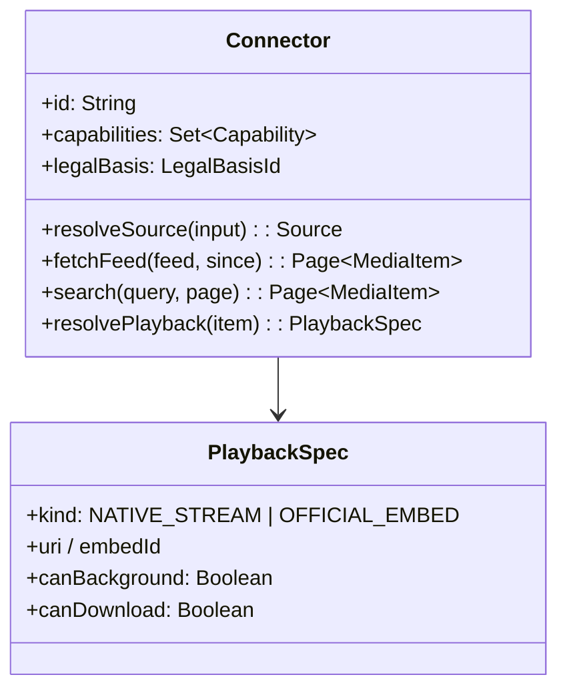
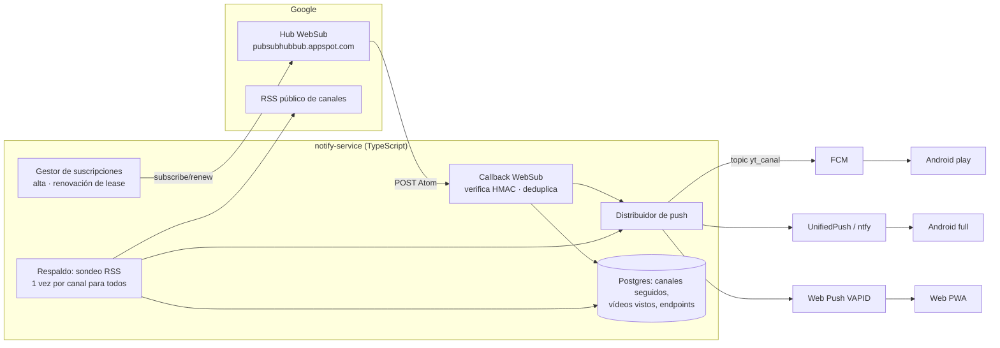

# Plan técnico: arquitectura Android, web y compartida

Estado: **Borrador para aprobación** · 2026-11-06 · Implementa: `spec.md`. Restringido por la constitución.

## 1. Principio rector: qué vive en el dispositivo y qué en el servidor

| Capacidad | Dispositivo | Servidor | Motivo |
|---|---|---|---|
| Biblioteca, historial, progreso, colecciones | ✅ (fuente de verdad local) | Réplica para sincronizar | Local-first (constitución §6) |
| Actualizar feeds (RSS, PeerTube) en Android | ✅ WorkManager | — | Sin coste de servidor; IP del usuario |
| Actualizar feeds en la web | — | ✅ **proxy de fetch** | **CORS**: el navegador no puede leer feeds RSS arbitrarios de otros orígenes [I: comportamiento estándar del navegador] |
| Reproducción | ✅ | — | El streaming va directo de la fuente al cliente; nunca pasa por el servidor (coste y ancho de banda) |
| Descargas | ✅ (Android) / 🟡 (web, caché de la PWA) | — | — |
| Búsqueda en la biblioteca | ✅ SQLite FTS5 | — | Offline |
| Búsqueda de contenido nuevo (PeerTube, Podcast Index) | ✅ directo a la API de la fuente | Proxy solo en la web, si hay CORS | — |
| Autenticación | — | ✅ | — |
| Sincronización | Motor en el cliente | ✅ relé y almacén | — |
| Transcripción | ✅ preferente (whisper.cpp) | Opt-in (GPU por lotes) | Privacidad y coste |
| Resúmenes y preguntas (LLM) | Experimental en local | ✅ opt-in | Coste por token |

Consecuencia económica: el servidor del MVP solo hace **autenticación, sincronización y proxy de feeds para la web**. Cabe en un único VPS pequeño con Postgres (estimación en `plan.md` §5).

## 2. Arquitectura general



## 3. Qué se comparte entre Android y web (ADR-001)

**Decisión:** compartir **contratos**, no código de UI ni el runtime.

| Se comparte | Cómo | Por qué |
|---|---|---|
| **Modelo de datos** | Esquemas JSON (JSON Schema) en `packages/contracts`, con generación de tipos para Kotlin (kotlinx-serialization) y TypeScript | Una sola definición; sin desincronizaciones |
| **Esquema SQL local** | Mismo DDL de SQLite en Android (Room) y en la web (SQLite-WASM) | Igual comportamiento de FTS, consultas y migraciones |
| **Protocolo de sincronización** | Especificación + **vectores de prueba de conformidad** (JSON) que ambos motores deben pasar | Garantiza la convergencia aunque haya dos implementaciones |
| **API del servidor** | OpenAPI 3.1 → clientes generados | — |
| **Conectores** (fase 3) | SDK en TypeScript que se ejecuta en Web Worker (web), Node (servidor) y QuickJS (Android) | Una implementación por fuente, como en Grayjay, que valida el patrón con V8 [V-código] |
| **Design tokens** | `tokens.json` → Compose `Theme` y CSS custom properties | Coherencia visual |

**Alternativas evaluadas:**
- **Kotlin Multiplatform para el dominio, compilado a JS para la web.** Pro: un solo motor de sincronización. Contra: interoperar con React es incómodo y aumenta el tamaño del bundle; Compose Multiplatform web sigue en beta [S]. **Se pospone**: se reevalúa en la fase 3 si el núcleo crece más de lo previsto.
- **Una sola app con Capacitor**, como Materialious [V-código]. Pro: una base de código. Contra: la reproducción en segundo plano, MediaSession, PiP, Android Auto y las descargas grandes son peores que con Media3 nativo [I]. **Se rechaza**, porque el reproductor es el corazón del producto.
- **React Native.** Mismo inconveniente que Capacitor en la integración multimedia profunda [I]. Se rechaza.

## 4. Producto A: Android

### 4.1 Stack (con justificación)
| Área | Elección | Justificación / alternativa descartada |
|---|---|---|
| Lenguaje | Kotlin 2.x | Estándar |
| UI | Jetpack Compose + Material 3 | Lo usan Flow, Metrolist y LibreTube [V-código]. Las Views son deuda (NewPipe, PipePipe). |
| Reproductor | **Media3** (ExoPlayer, `MediaSessionService`, `DownloadManager`, cast) | ExoPlayer 2 está obsoleto (NewPipe, PipePipe y SkyTube siguen en él) [V-código]. Media3 da notificación, segundo plano, Android Auto (`MediaLibraryService`) y cast. |
| Base de datos | Room sobre SQLite (FTS para búsqueda) | Estándar; mismo DDL que la web |
| Inyección de dependencias | **Hilt** | Validación en compilación; ecosistema (Flow y Metrolist lo usan). Koin (NewPipe) es más simple pero falla en tiempo de ejecución. |
| Asincronía | Corrutinas + Flow | RxJava es heredado |
| Red | OkHttp + kotlinx-serialization (Ktor client es una opción si se adopta KMP) | — |
| Trabajo en segundo plano | WorkManager (actualizar feeds, sincronizar, descargas largas) | — |
| Preferencias | DataStore | — |
| Imágenes | Coil 3 | — |
| Secretos | Android Keystore (tokens, credenciales de Jellyfin) | MASVS |
| YouTube | Reproductor IFrame oficial dentro de una WebView o `android-youtube-player` [NV: evaluar el cumplimiento de la RMF] | Constitución §3 |
| Navegación | Navigation Compose (type-safe) | — |
| Tests | JUnit5, Turbine, Robolectric, Compose UI test, Macrobenchmark + Baseline Profiles | RNF-001 |

### 4.2 Módulos Gradle
```
:app                       – ensamblado, navegación, inyección
:core:model                – tipos generados desde contracts
:core:database             – Room, DAOs, migraciones, FTS
:core:data                 – repositorios
:core:network              – OkHttp, cliente de la API propia
:core:sync                 – motor de sincronización (HLC, log de operaciones, LWW)
:core:player               – Media3: sesión, cola, perfiles de calidad, normalización
:core:download             – Media3 DownloadManager + políticas
:core:designsystem         – tema, tokens, componentes
:core:testing              – fakes y fixtures
:connector:api             – interfaz Connector (contrato)
:connector:rss             – RSS 2.0, Atom, Podcasting 2.0
:connector:peertube
:connector:local           – SAF / MediaStore
:connector:youtube-official – RSS de canal + embed (solo build `play`)
:connector:youtube          – cliente completo (solo build `full`, ADR-005): NewPipeExtractor,
                              PoToken/SABR delegados en la librería, SponsorBlock/DeArrow/RYD
:core:notifications         – receptor FCM / UnifiedPush, alarmas de estrenos, canales de notificación
:connector:jellyfin        – (fase 2)
:feature:home | :feature:search | :feature:player | :feature:library
:feature:subscriptions | :feature:history | :feature:downloads
:feature:settings | :feature:sources | :feature:profile | :feature:ai (fase 4)
```
Regla: `:feature:*` solo dependen de `:core:*` y de `:connector:api`, nunca de un conector concreto (constitución §12).

### 4.3 Reproductor
- Un solo `MediaSessionService` con un `ExoPlayer`. La UI se conecta mediante `MediaController`, lo que da segundo plano, notificación, pantalla de bloqueo y Bluetooth.
- **PiP:** `PictureInPictureParams` con `setAutoEnterEnabled` (Android 12+).
- **Cola:** persistida en Room, de modo que se restaura tras matar el proceso.
- Perfiles de calidad por tipo de red. Normalización y recorte de silencios con los audio processors de Media3.
- **Contenido de YouTube:** no pasa por Media3. Abre la pantalla del reproductor oficial. Al salir de la pantalla se pausa (sin segundo plano), y el PiP de YouTube queda deshabilitado mientras no se confirme que cumple las políticas [NV].

## 5. Producto B: web

### 5.1 Stack (ADR-002)
| Área | Elección | Justificación / alternativas |
|---|---|---|
| Framework | **React 19 + TypeScript + Vite** (SPA + PWA) | La app es privada: no necesita SSR ni SEO, así que Next.js añade complejidad de servidor sin beneficio. React tiene el mayor ecosistema y cantera de desarrolladores. **SvelteKit** es la alternativa seria: bundles más pequeños, y Materialious demuestra que funciona [V-código]. Elegir Svelte si el equipo ya lo domina. |
| Routing y datos | TanStack Router + TanStack Query | Tipado y caché |
| BD local | **SQLite-WASM (oficial) en OPFS**, en un Worker | Mismo DDL y FTS que Android. Fallback a IndexedDB si no hay OPFS [NV: comprobar Safari en un spike] |
| Reproductor | `<video>`/`<audio>` nativos + **hls.js** (PeerTube sirve HLS [I]); Media Session API; PiP API del navegador | Shaka solo si aparece una fuente DASH |
| YouTube | IFrame Player API oficial | Constitución §3 |
| PWA | vite-plugin-pwa (Workbox): app shell offline y caché de imágenes | — |
| UI | Componentes propios accesibles (Radix primitives) + CSS con tokens | Accesibilidad AA |
| Tests | Vitest, Playwright (incluido axe para accesibilidad) | — |

Limitaciones de la web que se documentan al usuario:
- Segundo plano dependiente del navegador (iOS Safari es restrictivo).
- Descargas grandes limitadas por la cuota de almacenamiento.
- La normalización con WebAudio necesita CORS en la fuente de audio [I].

### 5.2 Backend (ADR-003)
| Área | Elección | Justificación |
|---|---|---|
| Runtime | Node.js LTS + **Hono** | TypeScript compartido con la web y con la SDK de conectores (que corre en el servidor para el proxy de feeds); ligero |
| BD | **PostgreSQL 16+** | Fiable; JSONB para el log de operaciones; `tsvector` si hiciera falta búsqueda en servidor |
| Colas | **pg-boss** (sobre Postgres) | Evita Redis en el MVP (coste y operación) |
| Caché | En memoria + cabeceras HTTP (ETag) para feeds; Redis solo si se mide la necesidad | RNF-008 |
| Autenticación | **Passkeys (WebAuthn) + enlace por email**; tokens de sesión opacos en Postgres; refresh rotativo | Sin contraseñas; evaluar Better Auth frente a SimpleWebAuthn [NV madurez] |
| Tiempo real | WebSocket (avisos de “hay cambios” y control multidispositivo) | — |
| Almacenamiento de objetos | S3-compatible (opcional: copias de seguridad, transcripciones del servidor) | — |
| Observabilidad | Logs estructurados + OpenTelemetry autoalojado; **sin analítica de usuario** | Constitución §8 |
| Despliegue | Contenedor único + Postgres gestionado. Ruta de autoalojamiento con Docker Compose. | — |

## 6. Sincronización (núcleo diferencial)

- **Modelo:** cada cambio local es una **operación** `{opId, deviceId, hlc, entity, entityId, field, value}`. Los relojes HLC (Hybrid Logical Clock) dan un orden total.
- **Resolución de conflictos:**
  - campos escalares (título de colección, progreso): **LWW por campo**;
  - conjuntos (elementos de una colección, etiquetas): **OR-Set** (add-wins);
  - progreso de reproducción: gana el **máximo de `updatedAt`**, no la posición mayor (para que se pueda “rebobinar”).
- **Transporte:**
  - `POST /sync/push` (lote de operaciones);
  - `GET /sync/pull?since=<cursor>`;
  - WebSocket solo para avisar de que hay datos nuevos.
- **Servidor:** guarda el log por usuario y una instantánea compactada. Compacta los logs de más de 30 días.
- **Cifrado de extremo a extremo** (fase 5, opcional): las operaciones se cifran en el cliente con una clave derivada. El servidor solo ve blobs y metadatos de cursor. Coste: no hay búsqueda ni proxy del lado del servidor para esos datos.
- **Conformidad:** `packages/contracts/sync-vectors/*.json`, escenarios con estado inicial, operaciones de N dispositivos en distinto orden y estado final esperado. CI ejecuta los dos motores, Kotlin y TS.



## 7. Gestión de contenido y motor de búsqueda
- Entidades principales:
  - `Source` (fuente configurada);
  - `Feed` (suscripción);
  - `MediaItem` (episodio o vídeo, con `connectorId` y `externalId`);
  - `Progress`, `HistoryEvent`, `Collection`, `Tag`, `Bookmark`, `Download`;
  - `Transcript` (fase 4, segmentos con `startMs`).
- **Búsqueda local:** tabla virtual FTS5 con título, descripción, autor y notas de marcadores. En la fase 4 se añaden los segmentos de transcripción.
- **Búsqueda de contenido nuevo:** se delega en la API de cada conector (PeerTube `/search/videos`, Podcast Index `/search/byterm`) y los resultados se fusionan en la UI, agrupados por fuente.
- **Deduplicación:** el mismo episodio en dos feeds se agrupa por `guid` o URL de enclosure normalizada.

## 8. Descargas
- Android: Media3 `DownloadManager` + `DownloadService`.
  - Políticas: solo wifi, límite de espacio y autoborrado de lo ya visto.
  - Solo para conectores que declaran `canDownload` (constitución §2).
- Web: caché opcional de episodios mediante Cache Storage, con cuota visible.

## 9. Caché
| Nivel | Qué | Política |
|---|---|---|
| Cliente: HTTP | Feeds, miniaturas | ETag / Last-Modified; Coil con caché en disco de 250 MB |
| Cliente: BD | Metadatos | Permanente hasta que el usuario borra la fuente |
| Servidor: proxy de feeds | Respuestas de feed | TTL de 15 min por URL, compartido entre usuarios (reduce peticiones a las fuentes) |
| CDN | Assets de la web | Inmutables con hash |

## 10. Seguridad
- **Android:** MASVS-L1.
  - Tokens en Keystore; cleartext deshabilitado salvo red local (Jellyfin) con confirmación del usuario.
  - R8 activado; sin WebView con `addJavascriptInterface` para contenido remoto (el embed de YouTube va en una WebView aislada sin puente).
- **Web/API:** ASVS L2.
  - CSP estricta y cookies `HttpOnly` + `SameSite=Lax`.
  - Rate limiting por IP y usuario.
  - **Protección SSRF en el proxy de feeds**: el proxy debe bloquear IP privadas y link-local, limitar tamaño y tiempo, y seguir como máximo 3 redirecciones. Es el mayor riesgo de seguridad del backend.
- **Conectores de terceros** (fase 3):
  - **sandbox sin acceso a ficheros**, red limitada a los `allowedHosts` declarados, firma del autor y límites de CPU y memoria (patrón Grayjay [V-doc]);
  - sin primitivas de WebView ni de ejecución de JS remoto arbitrario (doc 05 §4).
- **Cadena de suministro:** Renovate, verificación de dependencias de Gradle, `npm audit` y builds reproducibles para F-Droid.

## 11. Sistema modular y de extensiones (respuesta al encargo §11)

| Módulo | ¿Independiente? | ¿Plugin? | Razón |
|---|---|---|---|
| Reproducción | Módulo interno `:core:player` | **No** | Crítico para rendimiento y seguridad |
| Descargas | Interno | No | Ligado al reproductor y a las políticas legales |
| Sincronización | Interno, protocolo versionado | No | La corrección es crítica; un plugin rompería la convergencia |
| Fuentes externas | **Sí: conectores** | **Sí** (fase 3), con SDK en sandbox | Es lo que más cambia; actualizar sin publicar la app (lección de Grayjay) |
| Podcasts | Conector de primera parte | No (nativo en el MVP) | Rendimiento y fiabilidad del núcleo |
| IA | Módulo `:feature:ai` + servicio opcional | No como plugin; sí con **proveedores intercambiables** (local o servidor) | Privacidad y control de costes |
| Personalización | Design tokens + ajustes | No | — |
| Estadísticas | Interno, local | No | Privacidad |
| Extensiones de UI (temas) | Temas declarativos (JSON) | Sí, sin código | Sin riesgo de seguridad |


`PlaybackSpec.kind = OFFICIAL_EMBED` obliga a la UI a usar el reproductor oficial y desactiva segundo plano y descarga. La constitución queda así impuesta **por tipo**, no por disciplina.

## 12. Módulo de YouTube completo (ADR-005)

- **Build:** solo en el *flavor* Gradle `full`. El *flavor* `play` usa `:connector:youtube-official`. Un test de CI verifica que el APK `play` no contiene clases de NewPipeExtractor (constitución §I.3).
- **Extracción:** **NewPipeExtractor** (GPL-3.0, la más mantenida: commit 2026-11-02, v0.26.5 [V-repo]). No se desarrolla un extractor propio. Lo que varía entre versiones de YouTube (PoToken, SABR) lo resuelve la librería y lo mantiene su comunidad. Contribuimos con parches upstream en lugar de hacer un fork.
- **Dónde se ejecuta:** **solo en el dispositivo**. El servidor no importa este módulo.
- **Reproducción:** `PlaybackSpec.kind = NATIVE_STREAM`, con Media3 (DASH/HLS, AV1/VP9), segundo plano, PiP y descargas por `:core:download`.
- **Integraciones:** SponsorBlock y DeArrow (API pública; licencia de datos CC BY-NC-SA [NV]) y RYD.
- **Recuperación rápida ante roturas** (la mayor debilidad de NewPipe):
  1. **Actualizador in-app** en la build `full`: consulta las releases firmadas de GitHub; si hay un hotfix, pide instalarlo. Así se publica en horas sin esperar a F-Droid.
  2. **Detector de roturas:** si fallan N reproducciones seguidas con el mismo error de extracción, la app muestra “YouTube cambió algo, buscando arreglo…” en vez de errores sueltos, y consulta el actualizador.
  3. **Fase 3:** estudiar mover el conector de YouTube al runtime de conectores JS (patrón Grayjay) para actualizarlo sin reinstalar la app. Hay que evaluar las políticas de F-Droid sobre código descargado [NV].
- **Login de YouTube** (opcional, fase 2): cookies guardadas solo en el Keystore, nunca enviadas a nuestro servidor. Advertencia al usuario: Google puede bloquear la cuenta [I].

## 13. Servicio de notificaciones en tiempo real (ADR-006)



- **Alta de canal:** el dispositivo comunica “sigo el canal X”. Con FCM se suscribe directamente al topic `yt_X` y avisa al servidor de forma anónima para que este se suscriba al hub si nadie lo hacía. Con UnifiedPush o Web Push, registra `endpoint → [canales]`.
- **Recepción:**
  - verificar la firma;
  - descartar los topics no suscritos;
  - `videoId` ya visto → es una edición, no se notifica;
  - `videoId` nuevo → push con el payload mínimo (`videoId`, `channelId`, `title`).
- **Dispositivo:** al recibir el push, obtiene los detalles con el extractor local y clasifica en vídeo, Short, estreno programado o directo.
  - Notifica con la miniatura.
  - Si es un estreno o directo programado, agenda una alarma exacta (`SCHEDULE_EXACT_ALARM` / `USE_EXACT_ALARM` según la versión de Android [NV: revisar la política de Google Play para la build `play`]).
- **Respaldo:**
  - en el servidor, sondeo del RSS cada 10–15 min por canal seguido;
  - en el dispositivo, sin push, sondeo local con WorkManager cada 15 min o más.
- **Escala:**
  - el coste depende del número de **canales distintos**, no de usuarios;
  - con 50 000 canales, renovar leases de 5 días son unas 7 renovaciones/min y el sondeo de respaldo cada 15 min unas 55 peticiones/s [I: cálculo aritmético]. Asumible para un servicio pequeño, y se puede bajar el respaldo a 30 min para los canales con WebSub sano.
- **Seguridad:** callback con un secreto por suscripción, rate limit, payloads acotados y sin datos personales.
